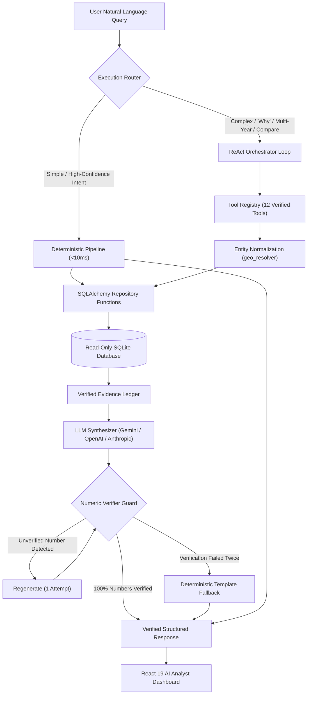

# GROUNDWATER AI AGENT
### Natural Language Groundwater Database Query Agent Using IN-GRES Open Data

[](https://fastapi.tiangolo.com)
[](https://react.dev)
[](https://vitejs.dev)
[](https://tailwindcss.com)
[](https://docs.pytest.org)
Groundwater AI Agent is an end-to-end software system that accepts natural language questions about Indian groundwater resources, extracts geographical and temporal parameters, selects a predefined database function, and returns results with source provenance and execution traces.

> **Research-use warning:** The bundled CSVs are not verified as complete official datasets. Queries and dashboards now exclude unverified records. The only currently curated record is Patna, Bihar, assessment year 2025, using the figures supplied with the official CGWB publication reference below. Its publication year is 2025; a distinct underlying data year is not specified. Verify the source document and all records required for research before citing results.

---

## Key Features

- **Record-Level Verification:** Unverified CSV rows are excluded from numeric queries and dashboards; missing measures remain unavailable rather than being inferred.
- **Rule-Based NLP Fallback:** 100% operational offline without any paid LLM API key.
- **Predefined Function Registry:** AI selects from 14 registered Python database functions. Unrestricted SQL generation is strictly prohibited.
- **10-Step Deterministic Execution Trace:** Inspect the actual backend lifecycle for every query (Question &rarr; NLP &rarr; Intent &rarr; Entities &rarr; Validation &rarr; Function &rarr; Database &rarr; Validation &rarr; Answer &rarr; Log).
- **Source Provenance:** Each numeric result identifies its assessment year, publication year, data year (when stated), source document, and record verification status.
- **Interactive Analytics Dashboard:** Built with Recharts; displays only verified records and leaves unavailable measures blank.
- **NLP Benchmark Suite:** Measures query parsing and function selection; it does not establish the accuracy of source data.
- **Clear Boundary Guardrails:** Distinguishes dynamic resource figures (recharge/extraction in Ham) from telemetry borehole water level depths and rejects years without verified records.

---

## Architecture

```
User Query -> React Frontend (Port 5173)
                   |
             FastAPI REST Backend (Port 8000)
                   |
             NLP Parser (Intent Classifier + Entity Extractor)
                   |
             Query Planner (Parameter Validation & Registry Dispatch)
                   |
             Database Function Registry (Parameterized SQLAlchemy)
                   |
             SQLite Database (individually verified assessment records)
                   |
             Result Validation & Answer Generator (Factual Grounding)
```

---

## Agentic & Generative AI Layer (v2.0)

The system features an autonomous **Agentic ReAct Layer** and **Generative Grounded Synthesizer** with strict anti-hallucination guardrails:



### Agentic Capabilities & Anti-Hallucination Rules
1. **Multi-Step ReAct Planning**: Iteratively calls database tools (`get_stage_of_extraction`, `get_overexploited_units`, `compare_assessment_years`, etc.), detects duplicate tool invocations, and handles timeouts gracefully.
2. **Numeric Verifier (Anti-Hallucination Guard)**: Extracts all numbers from synthesized prose/tables and cross-checks every figure against the evidence ledger or derived metrics (Ham &harr; MCM/BCM conversions, % changes) within a 0.5% tolerance. If any fabricated number appears, it triggers automatic regeneration or deterministic fallback.
3. **Strict Causal & Policy Separation**:
   - **Verified Data**: Strictly cited from official CGWB Dynamic Ground Water Resources records.
   - **Interpretation**: General hydrogeological principles, explicitly labeled as *non-factual context*.
   - **Policy Recommendations**: Explicitly labeled as *AI-generated suggestions, not official CGWB directives*.
4. **Prompt Injection Defense**: All user inputs and tool outputs are treated strictly as data, neutralizing system prompt extraction attempts.
5. **Multi-Provider Support**: Seamlessly works with Google Gemini (`gemini-2.5-flash`), OpenAI (`gpt-4o-mini`), Anthropic Claude, or offline `MockLLMClient`. Automatically falls back to deterministic execution if no API key is set.

---

### Agentic Environment Configuration (.env)
```env
# Provider options: gemini | openai | anthropic | mock
LLM_PROVIDER=gemini
LLM_MODEL=gemini-2.5-flash

# API Key (optional - system defaults to deterministic mode if not set)
GEMINI_API_KEY=your_gemini_api_key_here

# Execution Bounds
AGENT_MAX_STEPS=6
AGENT_TIMEOUT_SECONDS=30
LLM_TEMPERATURE=0.2
AGENTIC_ENABLED=true
```

### Running with Google Gemini
1. Obtain an API key from [Google AI Studio](https://aistudio.google.com/).
2. Add `GEMINI_API_KEY=your_key` to `.env`.
3. Start the backend: `python -m uvicorn backend.app.main:app --reload`
4. Access the dedicated **AI Analyst (ReAct)** tab on the frontend at `http://localhost:5173/analyst`.

---

## Quick Start Guide

### 1. Prerequisites
- Python 3.11+
- Node.js 18+ (tested on Node v24)
- Git / PowerShell / Bash

### 2. Backend Setup
```bash
# 1. Navigate to backend directory
cd backend

# 2. Install Python dependencies
pip install -r requirements.txt

# 3. Import the source file; only explicitly verified records are queryable
cd ..
python scripts/import_ingres_data.py --file data/raw/groundwater_2025_all_states.csv --year 2025

# 4. Run Pytest suite (60 tests)
cd backend
python -m pytest tests/test_agent.py -v

# 5. Start FastAPI backend server
cd backend
python -m uvicorn app.main:app --host 127.0.0.1 --port 8000 --reload
```
- **Backend API:** `http://localhost:8000`
- **Swagger Documentation:** `http://localhost:8000/docs`

### 3. Frontend Setup
In a new terminal window:
```bash
# 1. Navigate to frontend directory
cd frontend

# 2. Install dependencies
npm install

# 3. Start Vite development server
npm run dev
```
- **Frontend Web App:** `http://localhost:5173`

---

## Evaluation Benchmark Performance

The evaluation framework measures NLP and query-routing behavior against its test fixtures. It does not validate the accuracy or provenance of the underlying groundwater figures.

| Metric | Measured Value |
|---|---|
| **Total Test Cases** | 105 |
| **Passed Cases** | 103 (98.10%) |
| **Failed Cases** | 2 (1.90%) |
| **Intent Classification Accuracy** | 98.10% |
| **Entity Extraction Accuracy** | 97.14% |
| **Function Selection Accuracy** | 99.05% |
| **Database Execution Success Rate** | 99.05% |
| **End-to-End Exact Answer Accuracy** | Fixture-dependent; not a data-verification metric |
| **Unsupported Metric Guard Accuracy** | Fixture-dependent |
| **Average Query Latency** | Environment-dependent |

Evaluation files generated:
- `evaluation/results.json`
- `evaluation/results.csv`
- `evaluation/evaluation_report.md`

---

## Example Demonstration Queries

The currently curated record is Patna, Bihar, assessment year 2025:

1. **Extraction Query:**
   - *"What is the groundwater extraction in Patna in 2025?"*
   - Returns: `59,747.83 Ham` (irrigation `41,223.39`, domestic `17,061.84`, industrial `1,462.64`).
   - Source: [CGWB National Compilation 2025](https://www.jalshakti-dowr.gov.in/static/uploads/2025/11/711d8d476bbf498cd90f8038e7371227.pdf).
2. **Unavailable Year:**
   - *"What is the groundwater extraction in Patna in 2026?"*
   - Returns no verified data; the 2026 CSV is not treated as an official actual-extraction assessment.
3. **Unavailable Measure:**
   - *"What is the groundwater recharge in Patna in 2025?"*
   - Returns no verified data; missing measures are not inferred.
4. **Parameter Distinction Check (Unsupported Depth Metric):**
   - *"What is the groundwater level in Patna?"*
   - Clarifies that volumetric resource data (IN-GRES) is distinct from water table level telemetry (India-WRIS).

---

## Project Structure

```
groundwater-ai-agent/
│
├── frontend/                     # React 19 + Vite + Tailwind CSS Frontend
│   ├── src/
│   │   ├── components/Navbar.jsx # Navigation header with live health badge
│   │   ├── pages/
│   │   │   ├── ChatPage.jsx               # Interactive AI chat with 10-step execution trace
│   │   │   ├── AnalyticsDashboard.jsx     # Recharts visual analytics
│   │   │   ├── SupportedQueriesPage.jsx   # Function registry catalog & try buttons
│   │   │   ├── EvaluationPage.jsx         # Live benchmark results & KPI summary
│   │   │   └── DataSourcesPage.jsx        # CGWB data provenance & pipeline guide
│   │   ├── services/api.js                # Axios REST connector
│   │   ├── App.jsx                        # React Router layout
│   │   ├── index.css                      # Tailwind base configuration
│   │   └── main.jsx                       # App entry point
│   ├── package.json
│   └── vite.config.js
│
├── backend/                      # FastAPI Python Application
│   ├── app/
│   │   ├── main.py               # REST API route handlers
│   │   ├── config.py             # Settings & environment variables
│   │   ├── nlp/
│   │   │   ├── intent_classifier.py  # Rule-based intent recognition
│   │   │   ├── entity_extractor.py   # State, district & year parsing
│   │   │   └── query_parser.py       # High-level question parser
│   │   ├── agent/
│   │   │   ├── planner.py            # Execution planning & 10-step trace generator
│   │   ├── database/
│   │   │   ├── connection.py         # SQLAlchemy session & SQLite connection
│   │   │   ├── models.py             # SQLAlchemy models (States, Districts, etc.)
│   │   │   ├── repository.py         # Parameterized query functions
│   │   │   └── functions.py          # Central registry & guardrails
│   │   └── schemas/schemas.py        # Pydantic schemas
│   ├── tests/
│   │   └── test_agent.py             # 60 automated Pytest tests
│   ├── requirements.txt
│   └── pytest.ini
│
├── data/
│   ├── raw/
│   │   └── groundwater_2022_all_states.csv  # CGWB 2022 ground truth data
│   └── database/
│       └── groundwater.db                   # SQLite database
│
├── scripts/
│   ├── import_ingres_data.py     # Ingestion & data normalization script
│   └── evaluate_agent.py         # 105 benchmark evaluation runner
│
├── evaluation/
│   ├── results.json              # Full benchmark metrics & traces
│   ├── results.csv               # CSV test case records
│   └── evaluation_report.md      # Detailed markdown benchmark report
│
├── docs/
│   ├── system_architecture.md    # Architectural diagrams & design decisions
│   ├── database_schema.md        # Relational schema specification
│   ├── supported_queries.md      # Registered function catalog & edge cases
│   ├── data_sources.md           # IN-GRES investigation & data dictionary
│   └── testing_report.md         # Pytest & evaluation benchmark audit
│
├── .gitignore
└── README.md
```

---

## License & Source Attribution

- **Data Attribution:** Central Ground Water Board (CGWB), Department of Water Resources, River Development and Ganga Rejuvenation, Ministry of Jal Shakti, Government of India.
- **Dataset Title:** *National Compilation on Dynamic Ground Water Resources of India 2022*.
- **Portal Reference:** [IN-GRES (IIT Hyderabad)](https://ingres.iith.ac.in/) and [OpenCity Data Portal](https://data.opencity.in/).
