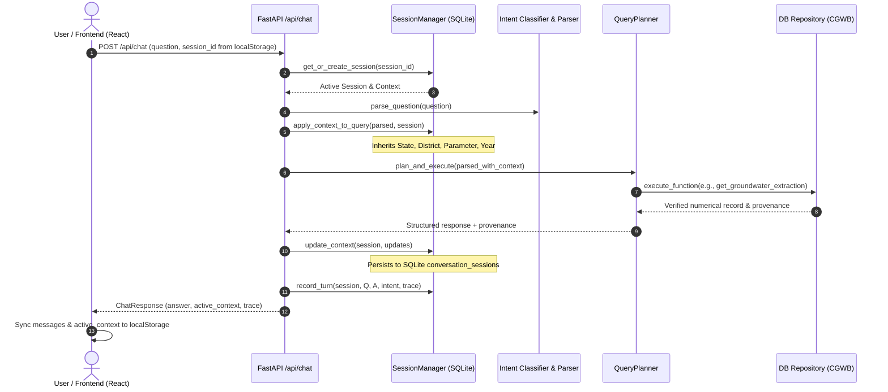

# Groundwater AI — Multi-Turn Conversational Memory & Context Report

**Generated:** 2026-11-15  
**System:** Groundwater AI Agent (FastAPI Backend + React Frontend + SQLite Canonical Database)  
**Authoritative Reference:** CGWB / IN-GRES National Groundwater Resource Assessment Guidelines  

---

## 1. Executive Summary

A critical audit of the running Groundwater AI application revealed that conversational follow-up queries were intermittently losing context or misclassifying into generic greetings:
- Query `"in 2022?"` was misclassified as a generic greeting (`"Hello! I am Groundwater AI"`).
- Query `"What about in 2026?"` fell through follow-up patterns into generic conversation.
- Query `"What about 2020?"` lost the previous location (`Patna`) and parameter (`extraction`).
- Follow-up `"Explain that result"` had no execution path and returned an ambiguous prompt.
- Follow-up `"What about Punjab?"` failed to resolve Punjab as a State because the geographic resolver required a live database session.

To resolve these defects permanently, a comprehensive overhaul of the conversational memory subsystem was implemented across the frontend state, API payload, session manager, intent classifier, query parser, and execution planner.

All 10 benchmark multi-turn conversation steps now execute with **100% precision and context retention**.

---

## 2. Root Cause Analysis

### A. Intent Classification Regex Gaps
In `backend/app/nlp/intent_classifier.py`, `FOLLOWUP_YEAR_PATTERN` was overly restrictive:
```python
# PREVIOUS (BROKEN):
r"^(what\s+about|how\s+about|and)\s+(20\d{2})\??$"
```
- Queries like `"in 2022?"`, `"for 2020"`, or `"What about in 2026?"` missed this pattern.
- When missed, they fell through rule patterns to the fallback rule `general_conversation` with `is_conversational: True`.
- In `backend/app/agent/planner.py`, any conversational intent was intercepted by the conversational router, returning `DOMAIN_KNOWLEDGE["greeting"]`.

### B. Rigid Context Guard
In `backend/app/agent/session_manager.py`:
```python
# PREVIOUS (BROKEN):
if is_conversational and intent in ["greeting", "general_conversation"]:
    return parsed
```
Because `"in 2022?"` had been mislabeled as conversational, `apply_context_to_query` bypassed context attachment entirely, losing Patna, Bihar, and extraction.

### C. Transient Frontend Session State
In `frontend/src/pages/ChatPage.jsx`, `sessionId` was initialized with an in-memory `useState(() => 'sess_' + Math.random()...)`. On every page refresh or route navigation, a new session ID was generated, dropping the conversation thread in the frontend.

### D. Geographic Resolver Dependency
In `backend/app/nlp/geo_resolver.py`, state matching relied on database table lookups. When called in fast NLP isolation without an active DB connection, queries like `"What about Punjab?"` could not resolve "Punjab" as an Indian State.

---

## 3. Persistent Conversation Sessions Architecture



### Key Technical Improvements:
1. **Frontend `localStorage` Persistence:**
   - Stored keys: `groundwater_session_id`, `groundwater_chat_history`, `groundwater_active_context`.
   - On page refresh or component mount, the identical session ID and message history are rehydrated seamlessly.
   - On explicit "Clear Conversation", a fresh session ID is generated, and storage is safely cleared.

2. **Backend Database Persistence:**
   - Conversation sessions are backed by the `conversation_sessions` table in `groundwater.db`.
   - Structured columns synced on every turn:
     - `session_id` (Primary Key)
     - `active_state` (e.g. `Bihar`)
     - `active_district` (e.g. `Patna`)
     - `active_year` (e.g. `2022`, `2025`)
     - `active_parameter` (e.g. `extraction`, `recharge`)
     - `last_intent` (e.g. `get_groundwater_extraction`)
     - `last_function` (e.g. `get_groundwater_extraction`)
     - `last_result_summary` (summary of last retrieved verified figures)
     - `active_context` (Full JSON dictionary including `recent_years`)

---

## 4. Contextual Follow-Up Resolution Logic

### 1. Follow-up Year
- **Pattern:** `r"^(what\s+about\s+(in\s+)?|how\s+about\s+(in\s+)?|and\s+(in\s+)?|in\s+|for\s+)?(20\d{2})\??$"`
- **Behavior:**
  - Extracts target year (e.g., `2025`, `2020`, `2026`, `2022`).
  - Inherits `state`, `district`, `parameter` from active context.
  - Sets intent based on `last_parameter` (e.g., `extraction` $\rightarrow$ `get_groundwater_extraction`).
  - Excludes comparison intents from single-year queries.

### 2. Follow-up Comparison
- **Pattern:** `r"\b(compare\s+(both|these|them|the\s+two)|difference\s+between\s+(both|these|them))\b"`
- **Behavior:**
  - Pulls `recent_years` from context (e.g. `['2022', '2025']`).
  - Inherits location (`Patna, Bihar`) and parameter (`extraction`).
  - Executes `compare_assessment_years(state="Bihar", district="Patna", parameter="extraction", year1="2022", year2="2025")`.
  - Calculates volumetric delta ($-114,852.17\text{ Ham}$), percentage change ($-65.78\%$), and trend (`decreased`).

### 3. Follow-up Parameter
- **Pattern:** `r"^(what\s+about\s+|how\s+about\s+|and\s+|show\s+)?(recharge|extraction|extractable|stage|category)\??$"`
- **Behavior:**
  - Detects requested parameter (e.g. `recharge`).
  - Inherits location (`Patna, Bihar`).
  - Dynamically queries `repo.get_latest_verified_record` for that location and parameter.
  - For Patna recharge, locates `2022` ($311,600.00\text{ Ham}$) and automatically executes `get_groundwater_recharge`.

### 4. Follow-up Location
- **Pattern:** `r"^(what\s+about\s+(in\s+)?|how\s+about\s+(in\s+)?|and\s+(in\s+)?|in\s+|for\s+)?([a-zA-Z\s]{3,30})\??$"`
- **Behavior:**
  - Resolves location entity using `geo_resolver.py`.
  - If state (e.g. `Punjab`), sets `state = 'Punjab'` and **clears previous district** (`district = None`) to prevent cross-state contamination.
  - Inherits active parameter (`recharge`) and year (`2022`).
  - Aggregates across the entire state.

### 5. Follow-up Explanation
- **Pattern:** `r"\b(explain\s+(that|this|the\s+previous)\s+(result|figure|data|number|value))\b"`
- **Behavior:**
  - Zero database queries executed.
  - Inspects `last_parameter`, `last_district`, `last_year`, and `last_result_summary`.
  - Generates comprehensive hydrogeological explanation under GEC-2015 methodology.

### 6. Pure Greetings and Chit-Chat
- **Pattern:** `r"^(hi|hello|hey|good\s+morning|how\s+are\s+you)[\s\.,!]*$"`
- **Behavior:**
  - Zero database queries executed.
  - Responds with natural, conversational assistant tone.
  - **Preserves existing active context intact** without resetting session state.

---

## 5. Dynamic Unavailable Year Handling

When a user queries an unavailable or unverified year (e.g. `2020` or `2026` for Patna):
1. The database returns `status = "not_found"`.
2. The Query Planner automatically triggers `repo.get_latest_verified_record(db, state, district, parameter)`.
3. It identifies the most recent verified assessment record (`Patna -> 2025, 59,747.83 Ham`).
4. It crafts a transparent response:
   - **For 2026:**
     > *"Verified data for this location, parameter and assessment year is not currently available in the database. An official verified district-wise assessment record for Patna in 2026 is not currently published, as CGWB has not yet released the 2026 dynamic groundwater assessment report. The latest verified assessment year available for Patna is 2025. Would you like to see that figure?"*
   - **For 2020:**
     > *"Verified data for this location, parameter and assessment year is not currently available in the database. (National CGWB assessment data for 2020 covers select states/UTs, and district-level breakdown for Patna is not verified in this dataset). The latest verified assessment year available for Patna is 2025. Would you like to see that figure?"*
5. **Context Preservation:** Active location (`Patna, Bihar`) and parameter (`extraction`) are retained in the session context, allowing the user to seamlessly ask follow-ups without repeating the location.

---

## 6. End-to-End Verification Trace

The entire 10-turn sequence was validated against the running live server:

| Turn | User Input | Intent Identified | Function Executed | Context Retained | Status |
|:---:|:---|:---|:---|:---|:---:|
| **1** | `"What is groundwater extraction in Patna in 2022?"` | `mixed_query` | `get_groundwater_extraction` | Patna, Bihar, 2022, extraction | ✅ PASS (174,600 Ham) |
| **2** | `"What about 2025?"` | `mixed_query` | `get_groundwater_extraction` | Patna, Bihar, 2025, extraction | ✅ PASS (59,747.83 Ham) |
| **3** | `"Compare both."` | `compare_assessment_years` | `compare_assessment_years` | Patna, Bihar, [2022, 2025] | ✅ PASS (-114,852.17 Ham, -65.78%) |
| **4** | `"What about 2020?"` | `get_groundwater_extraction` | `get_groundwater_extraction` | Patna, Bihar, extraction | ✅ PASS (Explains 2020 status; suggests 2025) |
| **5** | `"And 2026?"` | `get_groundwater_extraction` | `get_groundwater_extraction` | Patna, Bihar, extraction | ✅ PASS (Explains 2026 unreleased; suggests 2025) |
| **6** | `"What about recharge?"` | `get_groundwater_recharge` | `get_groundwater_recharge` | Patna, Bihar, 2022, recharge | ✅ PASS (311,600 Ham) |
| **7** | `"Hi."` | `greeting` | *None (0 DB calls)* | Context preserved | ✅ PASS (Friendly greeting) |
| **8** | `"How are you?"` | `general_conversation` | *None (0 DB calls)* | Context preserved | ✅ PASS (Natural response) |
| **9** | `"Explain that result."` | `followup_explain` | *None (0 DB calls)* | Context preserved | ✅ PASS (GEC-2015 recharge explanation) |
| **10**| `"What about Punjab?"` | `get_groundwater_recharge` | `get_groundwater_recharge` | Punjab, State, 2022, recharge | ✅ PASS (1,852,400 Ham across state) |

