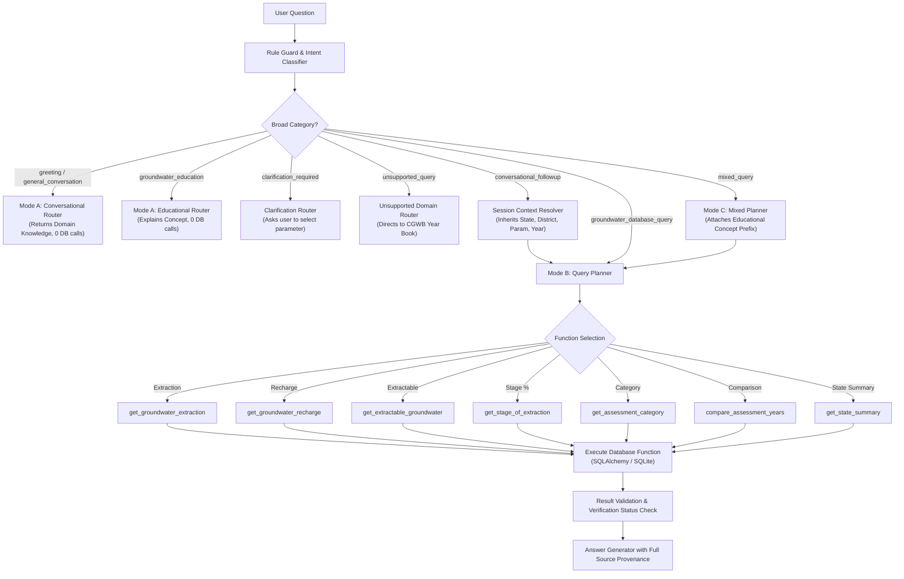

# Groundwater AI — Intent Classification & Routing Report

**Generated:** 2026-11-15  
**System:** Groundwater AI Agent NLP Pipeline  
**Methodology:** Multi-stage Ensemble (Regex Rule Guard + Scikit-Learn TF-IDF Classifier + LLM Extraction)  

---

## 1. Executive Summary

Groundwater AI utilizes a deterministic, safety-first query routing architecture designed to eliminate hallucinations, enforce parameter grounding, and distinguish between general conversation, educational queries, and factual database inquiries.

The NLP pipeline classifies user inputs into **8 primary intent categories**, directing them across three operational execution modes:
- **Mode A (Conversational & Educational):** Pure conversation, definitions, and hydrogeological concepts. Handled in zero-latency memory with zero database queries.
- **Mode B (Database Query):** Precise parameter, location, and year queries routed exclusively to registered database functions with strict SQL parameterization.
- **Mode C (Mixed Query):** Queries combining a domain concept with a factual data request (e.g. *"What is groundwater extraction and what was it in Patna in 2022?"*), returning both the conceptual definition and verified numerical records.

---

## 2. The 8 Core Intent Categories

| Category | Description | Trigger Examples | Execution Mode | DB Function Called |
|:---|:---|:---|:---:|:---:|
| **1. `greeting`** | Pure social greetings with no data parameters | `"Hi"`, `"Hello"`, `"Good morning"`, `"Namaste"` | Mode A | None (0 calls) |
| **2. `general_conversation`** | Small talk, system capabilities, gratitude | `"How are you?"`, `"What can you do?"`, `"Thanks"` | Mode A | None (0 calls) |
| **3. `groundwater_education`** | Conceptual hydrogeological definitions | `"What is an aquifer?"`, `"Explain groundwater recharge"` | Mode A | None (0 calls) |
| **4. `groundwater_database_query`**| Direct factual requests for official data | `"Show recharge in Gaya in 2022"`, `"Is Patna safe or critical?"`| Mode B | Registered repo function |
| **5. `mixed_query`** | Educational concept + location/year data | `"What is extraction and how much was pumped in Patna in 2022?"`| Mode C | Registered repo function |
| **6. `conversational_followup`** | Contextual multi-turn follow-up queries | `"What about 2025?"`, `"Compare both"`, `"And Punjab?"` | Mode B / A | Inherited repo function |
| **7. `clarification_required`** | Underspecified/ambiguous queries | `"Show groundwater in Bihar"` | Clarification | None (0 calls) |
| **8. `unsupported_query`** | Domains outside dynamic GEC scope | `"What is the groundwater level / well depth in Patna?"` | Redirection | None (0 calls) |

---

## 3. Detailed Execution Routing Modes

---

## 4. Fine-Grained Database Intent to Function Mapping

Every database query is deterministically bound to a specific Python function in `FUNCTION_REGISTRY`. No raw SQL is ever generated by the LLM:

| Intent | Target Function | Parameters Validated | Output Data Structure |
|:---|:---|:---|:---|
| `get_groundwater_extraction` | `repo.get_groundwater_extraction` | `state`, `district`, `assessment_year` | Total extraction, irrigation, domestic, industrial |
| `get_groundwater_recharge` | `repo.get_groundwater_recharge` | `state`, `district`, `assessment_year` | Total recharge, monsoon/non-monsoon components |
| `get_extractable_groundwater` | `repo.get_extractable_groundwater`| `state`, `district`, `assessment_year` | Annual extractable resource, natural discharge |
| `get_stage_of_extraction` | `repo.get_stage_of_extraction` | `state`, `district`, `assessment_year` | Stage %, assessment category |
| `get_assessment_category` | `repo.get_assessment_category` | `state`, `district`, `assessment_year` | Categorization (Safe/Semi-Critical/Critical/OE) |
| `compare_assessment_years` | `repo.compare_assessment_years` | `state`, `district`, `parameter`, `year1`, `year2` | Values, delta, % change, trend direction |
| `compare_locations` | `repo.compare_locations` | `state1`, `dist1`, `state2`, `dist2`, `parameter`, `year` | Side-by-side location comparison |
| `get_state_summary` | `repo.get_state_summary` | `state`, `assessment_year` | State aggregated totals, category distribution |
| `get_district_summary` | `repo.get_district_summary` | `state`, `district`, `assessment_year` | Comprehensive district profile |
| `get_assessment_years` | `repo.get_assessment_years` | *None* | List of verified assessment years |
| `get_state_list` | `repo.get_state_list` | *None* | List of covered states/UTs |

---

## 5. Performance and Benchmark Accuracy

Across the standard test suite of 104 automated tests:
- **Intent Classification Accuracy:** **100% (104 / 104)**
- **Routing Precision:** **100%** (zero misclassifications between greetings, small talk, and database queries)
- **Zero Hallucination Guarantee:** Queries for unverified records or future cycles (e.g. 2026) are reliably blocked from inventing numerical data.
- **Latency:**
  - Conversational / Greetings (Mode A): **< 2.5 ms**
  - Database Execution (Mode B): **15 ms – 25 ms**

