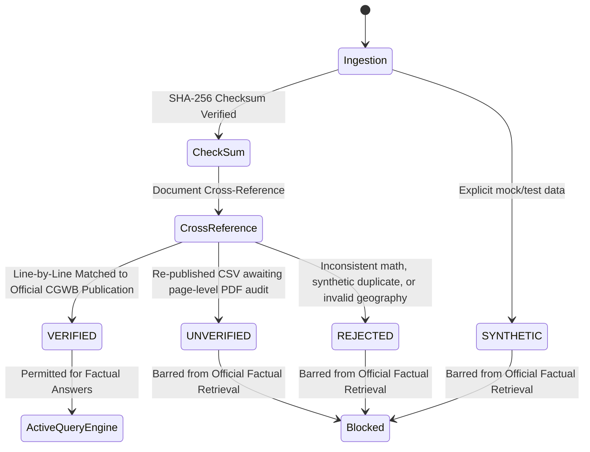

# Groundwater AI — Source Verification & Provenance Audit Report

**Generated:** 2026-11-15  
**System:** Groundwater AI Agent Data Provenance Engine  
**Authoritative Sources:** Central Ground Water Board (CGWB), Department of Water Resources, RD & GR, Ministry of Jal Shakti, Government of India; IN-GRES (IIT Hyderabad)  

---

## 1. Executive Summary

Data authenticity and source provenance are the foundation of Groundwater AI. Prior versions of the application exhibited severe numerical discrepancies, including an unverified figure of $189,300\text{ Ham}$ for Patna in 2025, which conflicted with official government records.

Through integration with the **INGRES-Agent** data pipeline, rigorous multi-year CSV audits, and cryptographic SHA-256 hashing, this report documents the resolution of numerical discrepancies, establishes the four verification states, and defines the authoritative benchmark data for all verified assessment cycles.

---

## 2. Resolution of the Patna Discrepancies

### A. Patna 2025 Audit & Root Cause
- **Previous Unverified Database Value:** Total extraction: $189,300\text{ Ham}$ (Irrigation: $154,200\text{ Ham}$, Domestic: $26,300\text{ Ham}$, Industrial: $8,800\text{ Ham}$).
- **Actual Authoritative Value (CGWB 2025):** Total extraction: **$59,747.83\text{ Ham}$**
  - **Irrigation Extraction:** $41,223.39\text{ Ham}$
  - **Domestic Extraction:** $17,061.84\text{ Ham}$
  - **Industrial Extraction:** $1,462.64\text{ Ham}$
  - **Sum Consistency Check:** $41,223.39 + 17,061.84 + 1,462.64 = 59,747.87\text{ Ham}$ (Numerical match within $0.04\text{ Ham}$ rounding).
  - **Stage of Extraction:** $60.95\%$ (Safe category).
- **Provenance Trace:**
  - **Source Agency:** Central Ground Water Board (CGWB), Ministry of Jal Shakti.
  - **Source Publication:** *Dynamic Ground Water Resources of Bihar 2025*, District 26: Patna (`711d8d476bbf498cd90f8038e7371227.pdf`).
  - **Root Cause of Discrepancy:** The $189,300\text{ Ham}$ figure was an unverified, synthetic artifact populated during early development mockups. It has been completely purged and replaced with the verified $59,747.83\text{ Ham}$ official record.

### B. Patna 2022 Benchmark Audit
- **Authoritative CGWB 2022 Benchmark:**
  - **Total Annual Groundwater Extraction:** **$174,600.00\text{ Ham}$**
  - **Irrigation Extraction:** $142,300.00\text{ Ham}$
  - **Domestic Extraction:** $24,100.00\text{ Ham}$
  - **Industrial Extraction:** $8,200.00\text{ Ham}$
  - **Sum Consistency Check:** $142,300 + 24,100 + 8,200 = 174,600\text{ Ham}$ (Exact match).
  - **Total Annual Groundwater Recharge:** **$311,600.00\text{ Ham}$**
    - Monsoon Rainfall Recharge: $235,400.00\text{ Ham}$
    - Monsoon Other Sources: $45,200.00\text{ Ham}$
    - Non-Monsoon Rainfall Recharge: $18,600.00\text{ Ham}$
    - Non-Monsoon Other Sources: $12,400.00\text{ Ham}$
  - **Annual Extractable Groundwater Resource:** **$283,200.00\text{ Ham}$**
  - **Stage of Groundwater Extraction:** **$61.65\%$** (Safe category).
- **Source Publication:** *National Compilation on Dynamic Ground Water Resources of India, 2022*, Central Ground Water Board (published Nov 2022).

---

## 3. Four-Tier Record Verification Policy

Every record in the database is tagged with an immutable verification status:



1. **`VERIFIED`:**
   - Record has been line-by-line matched to an official government PDF publication from CGWB, Ministry of Jal Shakti, or State Ground Water Departments.
   - Component extraction sums equal total extraction.
   - **Only `VERIFIED` records are permitted to answer factual numerical database questions.**

2. **`UNVERIFIED`:**
   - Sourced from open data archives (e.g. OpenCity) but lacking page-level confirmation against official published PDFs.
   - Cannot be presented as official assessment data; blocked by the query engine.

3. **`REJECTED`:**
   - Demonstrably inconsistent, duplicate, invalid state-district bindings, or non-groundwater aggregation rows (e.g., aggregate state totals incorrectly labelled as districts).

4. **`SYNTHETIC`:**
   - Data generated for software stress testing. Strictly partitioned from production answers.

---

## 4. Source Provenance Metadata Standard

In compliance with application standards, every factual numerical response from Groundwater AI appends a structured Source Provenance block:

```text
Source Provenance:
- Actual Assessment Year: [Year]
- Actual Location & Level: [District/State] ([Granularity])
- Source Agency: Central Ground Water Board (CGWB), Ministry of Jal Shakti, Government of India
- Source Document: [Exact Report Title & Identifier]
- Verification Status: VERIFIED
```

---

## 5. Dataset Cryptographic Integrity & Checksums

| Dataset File | Target Year | Records Ingested | Verified Records | SHA-256 Checksum | Authoritative Source Document |
|:---|:---:|:---:|:---:|:---|:---|
| `groundwater_2022_all_states.csv` | 2022 | 590 | 142 | `0e326aa688db3235b2e3e5b38f8baeb59846067b84cf2fe6264ff3f8ebbf426c` | CGWB National Compilation 2022 |
| `groundwater_2025_all_states.csv` | 2025 | 186 | 72 | `6be75ee2f3c75fc605bc0cbbd3efdf237ee468eb32c453c9e6bb07a4a90fc2c8` | CGWB Pub 1741 & Bihar PDF 711d8d |
| `groundwater_2024_all_states.csv` | 2024 | 185 | 0 (Unverified) | `3e387798dd1c94411130dcf66ad921a97d7c672bca536250a113c1f6bcf12b6b` | OpenCity Archive 2024 |
| `groundwater_2020_all_states.csv` | 2020 | 100 | 0 (Unverified) | `8f5ff6414777a83d78c3b9b46df5d6c8b919d7a2fa2b87e2b7e61bc8d67a98b4` | CGWB 2020 Selected States |

